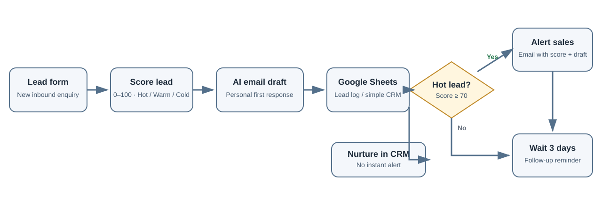

# Inbound Lead Automation with n8n and AI

An **n8n** workflow that takes a new inbound lead from a web form, **scores it automatically**, uses **AI to draft a personal first email**, logs everything to a **Google Sheet** that acts as a simple CRM, **alerts sales instantly** about hot leads, and sends a **follow-up reminder** three days later.

It replaces the manual steps a sales or marketing team usually does for every new lead: reading the form, judging how promising it is, copying it into a spreadsheet, writing the first email and remembering to follow up.



---

## The problem

When inbound leads arrive, someone has to:

1. read each form submission,
2. decide whether it's worth a call now or later,
3. copy the details into a CRM or spreadsheet,
4. write a first reply,
5. remember to follow up.

Done by hand, this is slow and inconsistent. The best leads can wait hours, and follow-ups get forgotten. **Speed to lead matters:** the faster a hot lead is contacted, the higher the chance of booking a meeting.

## What the workflow does

| Step | n8n node | What happens |
|---|---|---|
| 1 | **Form Trigger** | A lead fills in a form: name, work email, company, size, role, budget, timeline, need |
| 2 | **Code: Score Lead** | A transparent rule-based score from 0 to 100, labelled **Hot** (70+), **Warm** (40–69) or **Cold** (under 40) |
| 3 | **HTTP Request: OpenAI** | AI writes a short, personal first email (max 90 words) based on the lead's company and need |
| 4 | **Code: Combine** | Merges the lead, score and AI email. If the AI fails, a fallback text keeps the flow running |
| 5 | **Google Sheets** | Appends the lead to a `Leads` sheet, which works as a lightweight CRM |
| 6 | **IF: Is Hot Lead?** | Only hot leads trigger an alert |
| 7 | **Gmail: Alert Sales** | Instant email to sales with all details, the score explanation and the AI draft to review |
| 8 | **Wait + Gmail** | After 3 days, a reminder to follow up if no meeting is booked yet |

### Why rule-based scoring and AI only for writing?

The **score** must be predictable and explainable to the sales team, so it uses clear rules and stores the reasons, for example *"Company size 1000+: +30; Budget Over €20k: +30"*. **AI** is used where it adds the most value: writing a personal, natural first email that a rep **reviews before sending**. Nothing is sent to the lead automatically.

### Scoring rules

| Factor | Points |
|---|---|
| Company size | 1–50: 5 · 51–200: 15 · 201–1000: 25 · 1000+: 30 |
| Budget | Under €5k: 5 · €5k–€20k: 20 · Over €20k: 30 · Not sure yet: 10 |
| Timeline | Within 1 month: 30 · 1–3 months: 15 · Later than 3 months: 5 |
| Decision-maker role (Head, Director, VP, C-level, Founder, Manager, Lead) | +10 |
| Free email domain (gmail.com, gmx.de, …) | −10 |

---

## Tested logic

The scoring function is kept in `src/score_lead.js` so it can be tested outside n8n:

```bash
node test/run_tests.js
```

```
PASS  Lena Hoffmann  score=100  tier=Hot   | Company size 1000+: +30; Budget Over €20k: +30; Timeline Within 1 month: +30; Decision-maker role: +10
PASS  Tom Becker     score= 60  tier=Warm  | Company size 51-200: +15; Budget €5k-€20k: +20; Timeline 1-3 months: +15; Decision-maker role: +10
PASS  Sara Kim       score=  5  tier=Cold  | Company size 1-50: +5; Budget Under €5k: +5; Timeline Later than 3 months: +5; Free email domain: -10
PASS  Jonas Weber    score= 50  tier=Warm  | Company size 201-1000: +25; Budget Not sure yet: +10; Timeline 1-3 months: +15

All tests passed
```

(The sample leads in `test/sample_leads.json` are fictional.)

---

## How to use it

1. In n8n, go to **Workflows → Import from file** and choose `workflow/lead_automation.json`.
2. Add credentials for **OpenAI**, **Google Sheets** and **Gmail**.
3. Create a Google Sheet with a tab named **`Leads`** and paste its URL into the **Log to CRM Sheet** node.
4. Replace `PASTE_SALES_TEAM_EMAIL_HERE` in both Gmail nodes with the sales inbox.
5. Open the **Lead Form** node, copy the form URL and submit a test lead.

## Project structure

```
lead-automation-n8n/
├── workflow/lead_automation.json   # import this into n8n
├── src/score_lead.js               # scoring logic (same code as in the n8n Code node)
├── test/run_tests.js               # tests for the scoring logic
├── test/sample_leads.json          # fictional test leads
└── docs/flow.png                   # workflow diagram
```

## Ideas to extend it

- Replace the Google Sheet with **HubSpot** or **Salesforce**
- Send hot-lead alerts to **Slack** instead of email
- Enrich leads with company data from the company website before scoring
- Weekly summary email: number of leads per tier and average response time

---

**Author:** Adiba Afzal · MA European Business Management · [LinkedIn](https://www.linkedin.com/in/adiba-afzal-siddique-8897731b1)
